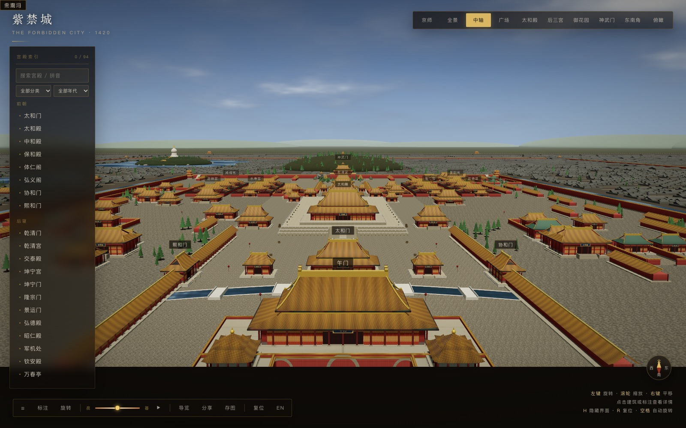

# 紫禁城 · 故宫 3D 交互展示

> 米制尺度、示意性的紫禁城与京师三维复原。宫城、皇城、内城、外城全部由代码在运行时程序化生成——仓库里没有一张外部模型或贴图素材。



*中轴视角：午门内侧北望，可见太和门、太和殿与景山。*

自由漫游中轴与两翼，十组预设机位，点开每座殿读它的来历；日照滑块从深夜拖到下一个深夜，可以播放昼夜流转，日落后星空、月亮、宫灯与窗纸的暖光一起亮起；支持雪、雨、秋色三套天候；五条导览线（中轴 / 六宫 / 东路 / 西路 / 京师）随时切换；搜索支持中文、英文、拼音全拼与首字母，还能检索词条正文、容模糊音与一个错字，并按分类和年代筛选；词条之间可以顺着相关建筑读下去。视野从宫城扩到京师：皇城、内城、外城三层城垣，十七座城门、天坛、先农坛、北海、中南海与景山都能点开读词条；外围是按胡同排布的四合院——近处是带院墙压顶、门楼与影壁的完整院落，远处是连排的灰瓦屋顶。天坛按清乾隆十九年（1754）定型格局重做：外坛 1703 × 1657 米、内坛 1025 × 1283 米，两重坛墙北圆南方，祈谷坛、圜丘坛、皇穹宇、斋宫与神乐署按实测尺度落位，柏林占其十九。三大殿的立面按面阔分间铺隔扇，太和殿明间敞开，从广场望进去是金柱与宝座的殿内进深；屋面按瓦垄铺出立体起伏。逛的时候可以按「探索」领一张清单（中轴十殿 / 六宫十二院 / 五处点景 / 两翼门殿 / 城门 / 散点拾遗），点开一座殿就算到过，走完一组给一次金色提示；按「明清」看八处有年代与依据的格局差异；按「漫游」走进院子，`WASD` 移动、抬头看匾、`Esc` 回到轨道视角。标注可按分类分组跳转（`[` / `]`），搜索命中的殿名会在画面里高亮；点「分享」复制的链接会带上天候、朝代、清单面板与标注分组。

**后续规划**见 [ROADMAP.md](./ROADMAP.md)，**已完成版本**见 [CHANGELOG.md](./CHANGELOG.md)。

---

## 一、这是什么

一个个人 3D 学习项目，也是一个可以离线分发的建筑科普展示。

| 是 | 不是 |
| --- | --- |
| 米制尺度搭建的示意性复原，重点在格局与形制关系 | 测绘级复原。开间、院落尺寸与实物存在偏差，不确定处标“示意” |
| 面向桌面 Chrome 的交互展示 | 移动端产品。窄窗口只保证布局不散架 |
| 科普展示为主，探索玩法只做“引导去看” | 积分、排行榜、每日任务式的运营化游戏 |
| 双击 `index.html` 即可运行 | 需要构建、安装依赖或联网的项目 |

---

## 二、快速开始

### 方式一：直接打开（推荐）

```bash
open index.html          # macOS
start index.html         # Windows
xdg-open index.html      # Linux
# 或在文件管理器中双击 index.html
```

Chrome 下 `file://` 通常可正常运行；Firefox 对本地文件的同源策略更严，若字体或贴图加载异常，改用方式二。

### 方式二：本地静态服务器

只在浏览器限制 `file://`，或需要固定端口做调试时使用。

```bash
cd path/to/project
python3 -m http.server 8931 --protocol HTTP/1.1
```

浏览器访问 <http://localhost:8931>。`--protocol HTTP/1.1` 不能省：python 默认用 HTTP/1.0 应答，Chrome 复用连接时会被单方面关闭，页面卡在加载层而服务端日志全是 200。需要 Python 3.7+。

**运行前提**：现代浏览器 + 开启硬件加速。直接运行不需要 Node.js、Python 或包管理器；本地服务器与截图回归才需要 `python3`。

---

## 三、操作速查

### 鼠标与触控

| 操作 | 方式 |
| --- | --- |
| 旋转 | 左键拖拽 / 单指拖动 |
| 缩放 | 滚轮 / 双指捏合 |
| 平移 | 右键拖拽 / Shift + 拖拽 |
| 打开建筑 | 点击建筑、城门、地标、标签或侧栏索引项 |
| 第一人称漫游 | 点「漫游」或按 `F`；鼠标转头（Pointer Lock 被拒时按住左键拖拽），点击准星所指建筑打开词条 |

### 键盘

| 键 | 默认状态 | 导览进行中 |
| --- | --- | --- |
| `0`–`9` | 切换预设机位 | 同左（下一站会接管镜头） |
| `R` | 复位到全景 | 同左 |
| `Space` | 自动旋转开关 | 暂停 / 继续导览 |
| `Esc` | 关闭信息卡 | 退出导览 |
| `←` `→` | — | 上一站 / 下一站 |
| `T` | 开始中轴导览 | 退出导览 |
| `Q` | 打开 / 关闭探索清单 | 同左 |
| `E` | 打开 / 关闭明清对比 | 同左 |
| `F` | 进入第一人称漫游 | 同左 |
| `[` `]` | 标注分组上一组 / 下一组（全部 → 前朝 → 后寝 → 东路 → 西路 → 城防 → 宫外） | 同左 |
| `H` | 隐藏 / 恢复全部界面 | 同左 |
| `Enter` | 焦点在标签、侧栏项或指北针上时触发对应动作 | 同左 |

**漫游中的键位**：`WASD` / 方向键移动，`Shift` 快走，鼠标转头，`Esc` 或 `F` 退出并回到轨道视角；此时其余全局键位不响应。

**生效条件**：焦点在搜索框内时，全局键位不响应，`Esc` 只清空搜索、不关信息卡；焦点在罗盘上时 `Enter` 把视角拉回正北。多义键的优先级按上表从左到右。

导览面板顶部有「中轴 / 六宫 / 东路 / 西路 / 京师」五个路线按钮，切换后从该线第 1 站重新开始；按钮本身可 Tab 聚焦、Enter 触发。搜索框可检索名称、英文名、拼音与词条正文；模糊音（`zh`/`z`、`n`/`l`、前后鼻音）与一个错字也能命中，模糊结果排在同组后面并加一条淡金色边线。

### 预设机位

| 数字键 | 按钮文案 | `?view=` | 取景 |
| --- | --- | --- | --- |
| `0` | 京师 | `capital` | 东南斜望，外城—内城—皇城三层城垣同框 |
| `1` | 全景 | `overview` | 皇城与内城，南向高空 |
| `2` | 中轴 | `axis` | 午门内侧，沿中轴北望 |
| `3` | 广场 | `taihe` | 太和殿广场中央 |
| `4` | 太和殿 | `close` | 太和殿前近景 |
| `5` | 后三宫 | `inner` | 乾清门内，望后三宫 |
| `6` | 御花园 | `garden` | 御花园南端北望 |
| `7` | 神武门 | `shenwu` | 故宫北端回望 |
| `8` | 俯瞰 | `top` | 正上方俯视 |
| `9` | 东南角 | `corner` | 东南角楼外侧 |
| — | （无按钮） | `detail` | 檐下细部，仅直链可用 |

---

## 四、URL 参数

所有参数可组合，适合做外部链接与调试对照。

| 参数 | 取值 | 作用 |
| --- | --- | --- |
| `view` | 见上表 | 直达机位，跳过飞行动画 |
| `select` | 建筑中文名，如 `太和殿` | 到达后自动打开该建筑信息卡 |
| `time` | `dawn` / `noon` / `dusk` / `night` / `0`–`1` | 初始时刻。**0 与 1 是深夜，0.25 日出，0.5 正午，0.75 日落** |
| `weather` | `clear` / `snow` / `rain` / `autumn` | 天候预设，默认 `clear` |
| `pos` | `x,y,z` | 直接指定相机位置 |
| `tgt` | `x,y,z` | 指定注视点（配合 `pos`） |
| `tour` | `1` | 加载后自动开始导览 |
| `quest` | `1` | 加载后打开探索清单 |
| `era` | `ming` / `qing` | 设定并打开朝代对比面板（默认 `qing`） |
| `fps` | `1` | 加载后进入第一人称漫游，**不请求 Pointer Lock**，供演示与自动化 |
| `labelgroup` | `前朝` / `后寝` / `东路` / `西路` / `城防` / `宫外` | 只显示该分类的建筑标注，其余标签移出 Tab 顺序 |
| `play` | `1` | 加载后自动播放昼夜流转（`still=1` 时忽略） |
| `lang` | `en` / `zh` | 界面语言，优先级高于本地记忆 |
| `exposure` | 浮点数 | 曝光倍率，覆盖默认值 |
| `sunmul` | 浮点数 | 太阳强度倍率 |
| `shadow` | `soft` / `hard` | 阴影模式。默认软阴影，软渲染环境自动退回硬边 |
| `stats` | `1` | 显示帧率、draw call、三角形数与显存对象数 |
| `seed` | `1` | 固定随机种子，截图回归用 |
| `still` | `1` | 冻结相机、导览、昼夜流转、云层、水面与天候粒子 |
| `nofade` | `1` | 加载层直接隐藏，不播 0.9s 淡出；截图回归专用 |

点「分享」会生成含 `pos` / `tgt` / `select` / `time` / `lang` / `weather` / `era` / `quest` / `labelgroup` 的链接；清单进度按约定不写进链接。

示例：

```text
http://localhost:8931/?view=close&select=太和殿&time=dusk
http://localhost:8931/?pos=0,80,300&tgt=0,30,150&exposure=1.1
http://localhost:8931/?tour=1&lang=en
http://localhost:8931/?time=night&weather=snow&view=garden
http://localhost:8931/?weather=rain&stats=1
```

---

## 五、当前状态

| 项 | 值 |
| --- | --- |
| 当前版本 | **v2.5**（v2.4 内容完成但 tag 未打，本轮又叠加「实用优先」五项；已打的最新 tag 仍是 `v2.3`；截图基线见 `docs/dev-tooling.md`） |
| 最后更新 | 2026-11-04 |
| 建筑词条 | 98 条，其中 97 条挂载到场景实体（`御花园` 为区域词条，无独立实体） |
| 已阅分母 | 97（按场景中不重名的词条计） |
| 匾额 | 77 块（65 块显式挂匾 + 六宫 12 院自动生成） |
| 导览 | 5 条线 / 59 站（中轴 / 六宫 / 东路 / 西路 / 京师） |
| 探索清单 | 6 组 / 59 项，判定复用「已阅」 |
| 引导覆盖 | 97 / 98 被导览、清单或朝代对比点名；唯一未点名的是无实体的区域词条「御花园」 |
| 搜索 | 名称 / 英文 / 拼音全拼 / 首字母 / 词条正文，模糊音与编辑距离 1 的错字容错，四级排序 |
| 标注分组 | 全部 + 六个分类，非本组标签移出 Tab 顺序；搜索命中高亮 |
| 朝代对比 | 明 / 清两档，8 处差异说明，只切文字不动几何 |
| 第一人称 | 宫城内漫游，`WASD` + 粗粒度碰撞 + 抬头看匾 |
| 天候 | `clear` / `snow` / `rain` / `autumn` 四套 |
| 四合院 | 1898 座完整院落（近景）+ 7924 段连排（远景，约 2.4 万间），共 6 个 `InstancedMesh` |
| 胡同 | 592 段街巷铺装，合并为 1 个 mesh |
| 规模 | `capital` 3146 draw call / 3.55 M 三角形，`overview` 2731 / 3.33 M（`tools/fps-bench.js` 实测） |
| 帧率基线 | `capital` 38.3 fps / `overview` 41.1 fps（M4 / Chrome 156 / ANGLE Metal / 1600×1000 / res 1.0；口径见 `docs/dev-tooling.md` 第九节） |
| 代码规模 | 13747 行原生 JS（不含 vendored Three.js） |
| 运行依赖 | Three.js r149 本地副本，无其他依赖 |
| 自测 | `tools/search-check.js` 83 条断言 / `tools/probe.sh v24` 27 项 + `v25` 27 项 + `deepLink` 5 项 / `pick` 101 条全命中，均全绿 |

以上数字由 `node tools/stats.js` 从 `js/data/info.js`、`js/palace.js`、`js/city.js` 与 `js/data/tour.js` / `quests.js` / `eras.js` 直接统计，不手工维护。改完建筑或词条后跑一次，再同步本节。`四合院` / `胡同` 两行取自 `tools/probe.sh city` 的运行时 `GG.city.stats`（探针默认 `view=capital`、`seed=1`、`still=1`，2026-11-03 实测），`规模` 与 `帧率基线` 两行取自 `node tools/fps-bench.js`（口径见 `docs/dev-tooling.md` 第九节）。

---

## 六、已知限制

| 限制 | 影响 |
| --- | --- |
| 布局逻辑拆成五段函数（`palace.js` 仍是最大的单文件，行数以 `node tools/stats.js` 为准） | 分段后可局部阅读，但共享量仍靠闭包传递 |
| 旧截图基线跑在 SwiftShader、v2.4 基线跑在 Metal | 两套后端不能逐像素比；v2.4 十张完整基线见 `tools/baseline/v2.4/` |
| 无单元测试、无 LOD | 纯函数改动靠人眼与截图，远景始终全精度渲染 |
| 水面为着色器示意 | 无真实倒影与水位；近景靠高频波纹补细节，岸线用浅滩带与条石驳岸补过渡，不做镜面 pass |
| 环境贴图为 PMREM 程序化烘焙四档 | 只在档位边界换贴图，晨昏过渡仍有轻微跳变；不是逐帧重烘 |
| 天候粒子域跟随相机（520 米） | 远景看不到雪 / 雨，只覆盖当前视野周边 |
| 已阅进度存 `localStorage` | 换浏览器或清缓存即丢；隐私模式下静默失效 |
| 搜索容错有边界 | 正文只做精确子串，不做错字容错；中文错字容错只比建筑名（一字数），拼音容错限编辑距离 1 与一次相邻换位。不做分词、同义词与语义检索 |
| 新增导览路线跨区域直飞 | 「京师」线从宫城切到外城坛庙是相机直飞，没有转场插值；六宫线跨 300 米同理（B17） |
| 清单六组需滚动 | 面板最高 `calc(100vh - 200px)`，第六组在折叠处以下，靠滚轮或键盘滚动 |
| 英文界面只翻译 UI | 词条正文保留中文，避免机器翻译替代史料表述 |
| 天坛的斗拱、瓦垄、石雕纹样为贴图 / 体量示意 | 祈年殿无室内藻井，圜丘栏板纹样未雕，回音壁三门是贴墙门洞；详见 `docs/tiantan.md` |
| 切换导览路线会从第 1 站重来 | 不能从当前站接着走；路线写死在 `js/data/tour.js`，暂无自定义编排 |
| 四合院分两层精度 | 近景 1150 米内是完整院落；再往外是 78 米一段的连排体块，近看没有门窗、院门与瓦垄 |
| 远景连排不参与阴影 | 视锥只覆盖宫城周边，连排投射会在视锥外被误判成全阴影，整片城市发黑 |
| 画布摘要是文字列表，不是空间描述 | `#scene-alt` 每约 2 秒刷新当前尺度、可见标注名与选中建筑，但不描述方位、遮挡与画面构图 |
| 第一人称只在宫城内活动 | 城外胡同是实例化体块，没有逐院碰撞；宫墙按整墙阻挡、城门洞不做通行判定，院墙也不挡人 |
| 朝代对比只切说明文字 | 不做建筑增删与复原动画，界面固定注明「示意对比，非史实复原动画」 |
| 清单第三组是「五处点景」而非「五处陈设」 | 日晷、嘉量、铜鼎没有独立词条，硬做会变成点开是空卡的幽灵条目 |
| 清单完成提示只弹一次 | 记在 `localStorage`，换浏览器或清缓存后会重新出现 |
| 帧率基线是 headless 口径 | 38.3 / 41.1 fps 用于同环境前后对照，不等同前台窗口读数；前台复核见 `ROADMAP.md` A5 |
| M7 的人工动作未完成 | 5 分钟可用性测试（A1）需真人，前台窗口复核（A5）需在普通终端执行；见 `ROADMAP.md` 第二节 |

---

## 七、文档索引

| 文件 | 内容 |
| --- | --- |
| [ROADMAP.md](./ROADMAP.md) | v2.5 之后仍未完成的事、M7 人工收尾、遗留编号、Backlog 与变更控制 |
| [CHANGELOG.md](./CHANGELOG.md) | 每个基线版本做了什么、放弃了什么 |
| [docs/architecture.md](docs/architecture.md) | 渲染管线、模块职责、坐标系、扩展指南 |
| [docs/tiantan.md](docs/tiantan.md) | 天坛复原依据、时期与范围、尺度表、材料与纹饰、取舍 |
| [docs/dev-tooling.md](docs/dev-tooling.md) | 截图回归流程、`shot.sh` / `diff.py` / `fps-bench.js` 用法、帧率与截图基线口径、踩坑清单 |
| [docs/content-guide.md](docs/content-guide.md) | 词条字段、术语表、匾额校核规则 |
| [docs/accessibility.md](docs/accessibility.md) | 无障碍自查报告 |

---

## 八、版权

- 渲染引擎：[Three.js](https://threejs.org/) r149，MIT License，版权归 Three.js Authors。
- 建筑名称、年代与简介参考公开史料整理，用于科普示意，不是测绘级复原。
- 本项目未附 `LICENSE`，默认保留所有权利；欢迎提问题与修正建议，暂不接受代码贡献。
