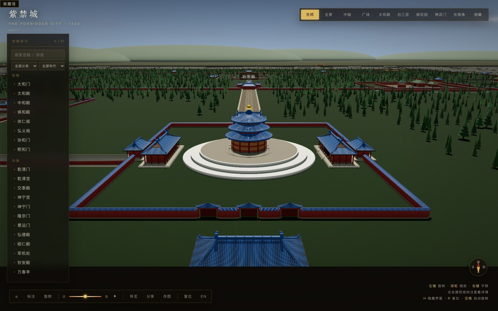

# 天坛复原说明

> 场景里的天坛不是「一座蓝顶圆殿」的剪影，而是按清乾隆十九年（1754）定型格局重做的坛域：
> 两重坛墙、四组主体建筑（祈谷坛、圜丘坛、斋宫、神乐署）与两处附属（皇穹宇、牺牲所），
> 尺寸取自公开测绘资料，形制与用色按明清坛庙制度。
> 本文说明复原依据、建筑范围、尺度来源，以及哪些地方是示意。



*场景实拍：从皇乾殿南望祈年殿。三重蓝琉璃檐、鎏金宝顶、三层台基与东西配殿。*

---

## 一、为什么是乾隆十九年

天坛从永乐十八年（1420）的天地坛，到嘉靖九年（1530）天地分祀，再到乾隆朝最后定型，
前后改过多次。场景取 **清乾隆十九年（1754）** 作为复原基准，理由有三条：

| 年份 | 事件 | 对形制的影响 |
| --- | --- | --- |
| 乾隆十二年（1747） | 内外坛墙包砌城砖 | 土墙变砖墙，才有今天看到的红墙蓝瓦 |
| 乾隆十四年（1749） | 圜丘扩建为三层 | 改蓝琉璃为艾叶青石台面、汉白玉栏板望柱 |
| 乾隆十六年（1751） | 大享殿改祈年殿 | 三重檐的上青、中黄、下绿三色瓦改为统一蓝琉璃 |
| 乾隆十七年（1752） | 皇穹宇改建 | 由重檐改为单檐圆殿，即今式 |
| 乾隆十九年（1754） | 神乐署定名 | 外坛西侧礼乐机构的名称与格局落定 |

这一轮之后，天坛的**总体格局再没有变过**。选它，是因为它同时满足三件事：

1. **形制最完整**：三重檐蓝瓦、三层圜丘、单檐皇穹宇、两重坛墙，都是后来照片里的样子。
2. **与场景其余部分同时代**：京师是清中期的城墙、城门与胡同，天坛若停在嘉靖朝，
   会出现「三色瓦大享殿 + 蓝琉璃圜丘」与清北京并置的错位。
3. **资料最扎实**：现存实测数据基本对应这一格局，可以直接落尺寸。

### 祈年殿的特殊说明

现存祈年殿是光绪十五年（1889）雷火之后，光绪二十二年（1896）按原制重建的。
**场景取现存殿身的形制**（二十八柱、三重圆檐、蓝瓦金顶），它与乾隆原制同构；
差异主要在斗拱细部与用材，不在体量与轮廓。这一点在词条里也写明了。

### 刻意不取的时期

- **嘉靖九年（1530）**：大享殿三色瓦（上青、中黄、下绿）、圜丘蓝琉璃、皇穹宇重檐。
  形制上很有辨识度，但与场景的清京师不属于同一时代。
- **光绪朝**：总体格局与乾隆相同，只有祈年殿是重建的。取乾隆 = 取格局，取现存殿身 = 取实物，
  两者并不矛盾。

---

## 二、建筑范围

坛域按实测的 **外坛 1703 × 1657 米（约 273 公顷）** 铺开，内坛 **1025 × 1283 米（约 130 公顷）**，
两重坛墙都是**北圆南方**：北墙是半圆，南墙与东西墙是直角。

```
外坛  x 1498.5 … 3201.5   z 2303 … 3960    北墙半圆 r 851.5
内坛  x 1837.5 … 2862.5   z 2357 … 3640    北墙半圆 r 512.5
```

### 建模的建筑组

| 组 | 内容 | 状态 |
| --- | --- | --- |
| 祈谷坛 | 祈年殿、三层圆台、祈年门、东西配殿、皇乾殿、内壝墙、三座琉璃门、燔炉与燎炉 | 全建 |
| 祈谷坛东 | 七十二长廊（350 米、72 间，曲尺形）、神厨院、七星石 | 全建 |
| 圜丘坛 | 三层圜丘、内圆外方两重壝墙、八组二十四座棂星门、燔柴炉、八燎炉、三望灯台、具服台、神库神厨 | 全建 |
| 皇穹宇 | 单檐圆殿、双层圆台、回音壁、南面三座琉璃门、东西配殿 | 全建 |
| 斋宫 | 两重宫墙、两道御沟、无梁殿、寝殿、钟楼、铜人亭、院内铺装 | 全建 |
| 神乐署 | 凝禧殿、显佑殿、院墙 | 体量 |
| 牺牲所 | 院墙与三座仓房 | 体量 |

### 坛门

- 外坛：西墙的**祈谷坛门**（北）与**圜丘坛门**（南）。明代只开西门，清代沿用。
- 内坛：**北天门、东天门、西天门、昭亨门、泰元门、广利门**六座。
- 祈谷坛：南面祈年门（五间庑殿），东西砖门，北面三座琉璃门通皇乾殿。
- 内坛东西隔墙：**成贞门**，丹陛桥南端。

### 不进场景的部分

- 内坛东侧的**神库、神厨、宰牲亭**只做了三座灰瓦体量，没有院墙与库房分间。
- 外坛的**钟楼、值房、井亭**等附属房舍未逐一建。
- 祈谷坛的**燔炉、瘗坎、八座铁燎炉**只在祈年门外留了位置，没有逐件建模。
- 圜丘的**望灯杆**做了三座，但杆顶的灯笼是简化方块。

---

## 三、尺度表

单位：米。带「示意」的是资料缺失处的合理推定，其余为实测或按实测换算。

| 项目 | 复原值 | 说明 |
| --- | --- | --- |
| 外坛 | 1703 × 1657 | 约 273 公顷；北墙半圆 r 851.5 |
| 内坛 | 1025 × 1283 | 约 130 公顷；北墙半圆 r 512.5 |
| 祈年殿 | 高 38.2，径 32.7 | 三重檐圆攒尖，蓝琉璃，鎏金宝顶 |
| 祈年殿柱网 | 28 柱 | 4 龙井柱 + 12 金柱 + 12 檐柱 |
| 祈谷坛台 | 三层 91 / 80 / 68，高 5.6 | 上层径 68、中层 80、下层 91 |
| 祈谷坛内壝 | 157.5 × 187.5 | 墙高 4.4，红墙蓝瓦 |
| 皇乾殿 | 五间，蓝瓦庑殿 | 月台，三座琉璃门 |
| 祈年门 | 五间，蓝瓦庑殿 | 中三间为门 |
| 丹陛桥 | 长 360、宽 30 | 北高 4.2、南高 1.5；中部走牲道券洞 |
| 皇穹宇 | 高 19.5，径 15.6 | 单檐蓝瓦攒尖，16 柱（8 檐 + 8 金） |
| 回音壁 | 径 61.5，高 3.72，厚 0.9 | 南面三座琉璃门 |
| 圜丘 | 高 5.17；三层 23.65 / 39.3 / 54.92 | 中层为上下层插值（示意） |
| 圜丘踏跺 | 四面各九级 | 每层四出陛 |
| 圜丘栏板 | 360 块 | 上层 72、中层 108、下层 180 |
| 圜丘壝墙 | 内圆 r 36，外方 130 × 130 | 红墙蓝瓦，八组棂星门 |
| 棂星门 | 每组三门，共 24 座 | 汉白玉，三间石坊 |
| 燔柴炉 | 径 3.6，高 4.4 | 绿琉璃砖，三面各九级 |
| 望灯台 | 三座，杆高 18 | 石台 + 灯杆 + 灯笼 |
| 斋宫 | 约 200 × 200（4 公顷） | 两重墙、两道御沟，绿琉璃 |
| 长廊 | 长 350、宽 5，72 间 | 灰筒瓦，曲尺形 |

### 与实测的偏差

- **位置**：坛域在场景里仍按京师棋盘摆放，中轴 x=2350、南墙 z=3960，不与现代北京坐标对齐。
- **圜丘中层**：公开资料只给上层 23.65、下层 54.92，中层按等比插值为 39.3。
- **斋宫范围**：资料说「近四公顷」，按 200 × 200 米取整。
- **坛墙周长**：不采用「外坛墙 6553 米」一说——它与 1703 × 1657 的包围盒在几何上矛盾，
  本场景按北墙半圆推算，约 7.7 公里。

---

## 四、材料与色彩

天坛的用色是一套制度，不是装饰偏好：

| 颜色 | 材料 | 用在哪 | 为什么 |
| --- | --- | --- | --- |
| 天坛蓝 | 蓝琉璃瓦 | 祈年殿、皇穹宇、祈年门、配殿、坛门、坛墙压顶 | 蓝色象天，只有祭天建筑能用 |
| 汉白玉 | 白石 | 祈谷坛台、圜丘栏板望柱、棂星门、皇穹宇台 | 石作最高等级 |
| 艾叶青 | 青灰石 | 圜丘坛面、九环扇面石 | 乾隆十四年改蓝琉璃为青石，现存原物 |
| 红 | 红墙 | 内外坛墙、祈谷坛内壝、壝墙 | 明清坛墙的底色 |
| 绿 | 绿琉璃 | 斋宫全部屋顶、燔柴炉 | 皇帝斋戒时自称天子，不能用祭天的蓝瓦 |
| 金 | 鎏金 | 祈年殿、皇穹宇宝顶，门钉，匾额边框 | 收顶与点睛 |

### 纹饰

- **祈年殿**：三重檐每层一圈瓦垄（0.55 米一垄），檐口一圈蓝琉璃瓦当；殿身十二间三交六椀菱花隔扇；
  额枋一圈和玺彩画，斗拱一圈青绿暗带。
- **圜丘**：坛面九环石，环数取九；栏板望柱按九数排布（上层 72、中层 108、下层 180）；
  四面棂星门为汉白玉三间石坊。每环的扇面石分块未逐块建模，几何上是九圈同心环。
- **祈谷坛台**：三层栏板，上层龙纹、中层凤纹、下层云纹——纹样不建模，只保留三层的高度与间距；
  南面三出陛，中间御路。
- **皇穹宇**：单檐瓦垄、鎏金宝顶；回音壁磨砖对缝，蓝瓦压顶；南面三座琉璃门。
- **斋宫**：绿琉璃庑殿、砖拱无梁殿（不露梁枋）。

---

## 五、取舍与已知简化

| 简化 | 原因 | 影响 |
| --- | --- | --- |
| 不做室内 | 殿门关闭，室内不可见 | 祈年殿的九龙藻井、龙凤石未建 |
| 斗拱是一圈暗带 + 贴图 | 逐攒斗拱在 300 米外不可辨，几何量过大 | 近看檐下没有真正的斗拱层 |
| 瓦垄是贴图 + 顶点明暗 | 逐张筒瓦的三角形量不可接受 | 近看屋面是平面，没有瓦件断面 |
| 栏板纹样不雕 | 石雕纹样在场景尺度不可见 | 上层龙、中层凤、下层云只保留在文档里 |
| 回音壁三座琉璃门是贴墙门洞 | 圆墙开洞要重做 Extrude 轮廓 | 门是「贴」在墙上的，不是真开口 |
| 祈年殿形制取光绪重建 | 乾隆原物已毁，现存即原制同构 | 斗拱细部与乾隆原制有差异 |
| 柏林是抖动网格 | 不按古树名录逐棵定位 | 树位可复现，但不是真实古树分布 |
| 神乐署、牺牲所只做体量 | 外坛西侧为远景 | 没有内部院落与廊房 |

### 坐标与性能

- 整个天坛不消耗 `Math.random`：柏林用整数哈希 + 21 米抖动网格，`?seed=1` 时位置固定。
- 只有祈年殿、圜丘、皇穹宇、斋宫、丹陛桥五处进索引（可点、有词条）；
  坛墙、栏板、棂星门、树全部并入静态合批。
- 外坛与内坛地坪不重叠：内坛从外坛地坪里挖出来，城市地坪再把整个外坛挖掉。
  三层地坪若互相压着，3 公里外深度精度不够，南半截会被城市地坪吃掉。

---

## 六、回归

```bash
node tools/stats.js          # 词条 / 挂载 / 行数
node tools/search-check.js   # 拼音、分类、rel 悬空
tools/shot.sh out "tt:pos=2350,620,4300&tgt=2350,20,3150"
```

天坛的固定机位建议：

| 名称 | 查询串 | 看什么 |
| --- | --- | --- |
| 全坛 | `pos=2350,3000,3400&tgt=2350,0,3300` | 北圆南方、两重坛墙、五组建筑 |
| 祈谷坛 | `pos=2350,70,2320&tgt=2350,22,2520` | 三重檐、三层台、皇乾殿 |
| 圜丘 | `pos=2350,120,3381&tgt=2350,0,3380` | 三层坛、九环石、棂星门 |
| 皇穹宇 | `pos=2350,36,3160&tgt=2350,14,3055` | 单檐圆殿、回音壁、琉璃门 |
| 斋宫 | `pos=2090,32,3190&tgt=1950,8,3060` | 两重墙、御沟、绿瓦 |

截图必须带 `?seed=1`；天坛柏林是哈希铺的，不带种子也能复现，但城市部分仍需固定。
